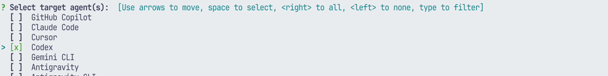
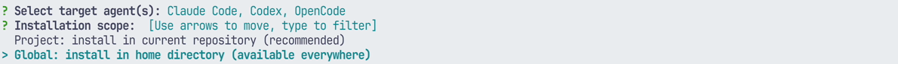

# 赤ペン先生（akapen）

We部の学生向けに、AIへ作業を頼む前の「これで進めてよい？」をブラウザで確認する Skill です。AIが1案をHTMLにし、あなたの回答を受け取ってから実装・修正を進めます。

## できること

- **標準**：画面・設計・方針を見て、選択肢への回答、全体コメント、赤ピンを返す。
- **指摘**：記事やREADMEの段落・文字に、直してほしい点を付ける。
- **添削**：ブラウザで文章を直接書き換え、完成形を返す。

## 必要なもの

- ローカルPCで動く Codex または Claude Code と、その利用設定・契約。Skill自体にAIは含まれません。
- Python **3.8以上**（追加のPythonライブラリは不要）、ブラウザ、Git。
- ターミナルで `python3 --version` と `git --version` が実行できること。

Codexを優先した設計で、Claude Codeは互換経路です。OpenCodeの配置先も下に示しますが、**OpenCodeでの動作は未検証**です。クラウド環境は正式対応外です。エージェントとブラウザを同じPCで使ってください。

## インストール

次のどちらか1つの方法を選んでください。以下はmacOS / Linuxのターミナル用です。WindowsではパスやPythonのコマンドを読み替えてください（Windowsでの動作は未検証）。既存の `akapen` がある場合は、内容を確認してバックアップしてから更新してください。

### 方法1：GitHub CLIでインストール

`gh skill --help` が使えるGitHub CLIが必要です（プレビュー機能）。使えない場合は方法2へ進んでください。

```sh
gh skill preview junhat6/akapen-skill akapen/SKILL.md
gh skill install junhat6/akapen-skill akapen/SKILL.md
```

ターミナルの対話画面で次のように選びます。

1. **Select target agent(s)**：矢印キーで移動し、Spaceで **Codex** または **Claude Code** を選択してEnter。両方も選べます。初期選択のGitHub Copilotが不要ならSpaceで外します。
2. **Installation scope**：複数のプロジェクトで使うなら **Global**、今のGitリポジトリだけなら **Project** を選んでEnter。

| 選択 | Codexの配置先 | Claude Codeの配置先 |
|---|---|---|
| Global | `~/.agents/skills/akapen` | `~/.claude/skills/akapen` |
| Project | `.agents/skills/akapen` | `.claude/skills/akapen` |

**画面の例**：提供された導入動画から、共通の選択操作だけを切り出しています。別Skillの導入動画のため、上の赤ペン先生用コマンドを使ってください。画像中のOpenCodeは操作例に含まれますが、赤ペン先生での動作は未検証です。





対話できる通常のターミナルで実行してください。パイプ経由など非対話実行では選択画面が出ず、既定値（GitHub Copilot・Project）が使われます。`akapen/SKILL.md` はこのリポジトリの実際のSkillパスです。

### 方法2：git cloneして手動で配置

まだ同名のフォルダがない作業場所で取得します。既にクローン済みの場合は、そのフォルダで更新してから配置してください。

```sh
git clone https://github.com/junhat6/akapen-skill.git
cd akapen-skill
```

続けて、利用するエージェントのコマンドを実行します。以下は配置先に `akapen` がまだない場合の手順です。既にある場合は「更新」を参照してください。

**Codexの場合：**

```sh
mkdir -p ~/.agents/skills
cp -R akapen ~/.agents/skills/akapen
```

**Claude Codeの場合：**

```sh
mkdir -p ~/.claude/skills
cp -R akapen ~/.claude/skills/akapen
```

`SKILL.md` だけでなく、`assets`・`references`・`agents` を含む `akapen` フォルダ全体をコピーします。

### インストール後

エージェントの新しい会話を始めて、下の「初めて使う」に進んでください。OpenCodeの配置候補は `~/.config/opencode/skills/akapen` ですが、OpenCodeでの動作は未検証です。

## 初めて使う

作業するプロジェクトをエージェントで開き、例えば次のように頼みます。

> 赤ペン先生で、学習記録アプリのトップ画面を作る前に1案を見せてください。まだ実装は始めないでください。

Codexでは `$akapen`、Claude Codeでは `/akapen` でも呼び出せます。文章なら「READMEを指摘モードで確認したい」「この記事を添削モードで直接直したい」と伝えます。

1. AIが `./akapen/<話題>-01.html` とローカルURLを作ります。
2. 提示されたリンクを自分で開き、HTML上で回答・指摘・編集します。
3. ブラウザの **［送信］** を押します。
4. エージェントとの会話へ戻り、**「回答しました」** と送ります。ブラウザの送信だけでは会話は再開しません。
5. AIが保存された回答を読み、反映します。未決定があれば次のシートで確認します。

`file://` で開いた場合は［貼り付ける文章を作る］を押し、できた全文を会話へ貼ってください。コピーできなければ画面のテキスト欄から手動でコピーします。

## 更新

更新前にエージェントの作業と中継サーバを終了し、配置済みの `akapen` フォルダをバックアップしてください。自分で変更したファイルがある場合は差分を確認します。

- **方法1で導入した場合**：`gh skill update --help` で利用中のCLIの更新オプションを確認し、対象のSkillを更新してください。
- **方法2で導入した場合**：最初にクローンした `akapen-skill` フォルダで `git pull --ff-only` を実行します。配置済みフォルダを別名へ移してから、方法2の該当するコピー手順で最新の `akapen` を配置してください。

## つまずいたら

| 症状 | 確認すること |
|---|---|
| Skillが見つからない | 配置先の `akapen/SKILL.md` を確認し、新しい会話で明示的に呼び出す |
| `python3` が見つからない | Python 3.8以上を導入する。必要ならAIに実行コマンドの読み替えを依頼する |
| リンクが開かない | AIとブラウザが同じPCか確認し、中継の再起動を依頼する。ポート番号はAIが実際に出したものを使う |
| 回答が届かない | ［送信］の完了表示を確認し、会話で「回答しました」と伝える。`file://` なら全文を貼る |
| 古い下書きが出る | AIに次の番号のシートを作ってもらう。下書きはブラウザ内にも保存される |

中継の確認・終了を手動で行う場合（Codexの配置例。作業プロジェクト内で実行）：

```sh
python3 ~/.agents/skills/akapen/assets/akapen-serve.py status ./akapen
python3 ~/.agents/skills/akapen/assets/akapen-serve.py stop ./akapen
```

## 安全に使うために

- 中継は `127.0.0.1` で動き、**HTMLの親フォルダ全体を静的配信**します。生成物専用の `./akapen/` を使い、秘密鍵・トークン・個人情報・非公開資料を置かないでください。機密ファイルへのシンボリックリンクも置かないでください。
- ポートをインターネットへ公開・転送しないでください。終了後は中継を止めます。
- HTMLには原稿や提案が埋め込まれ、回答は `.answer.txt` / `.answer.json` に保存されます。ブラウザ内の下書きも含め、共有PCやGitへの誤公開に注意してください。生成先をプロジェクトの `.gitignore` に追加することをおすすめします。
- 標準・添削テンプレートは **Google Fontsへ外部通信**します。オフラインでは代替フォントになります。完全に外部通信を止める必要がある場合は、使用前にHTMLのGoogle Fonts指定を除去してください。
- AIサービスに渡す内容は、そのサービスのデータ取扱い設定も確認してください。AIの提案・変更内容は自分で確認します。回答前の実装や自動commitを認めるSkillではありません。

## ライセンス

MIT License。既存コードの `Copyright (c) 2026 AI-Driven R&D Dept` と許諾文を [LICENSE](LICENSE) に保持しています。再配布時も著作権表示と許諾文を保持してください。
